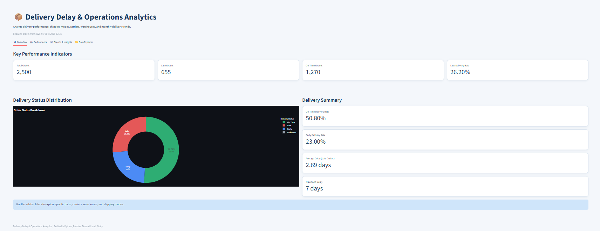
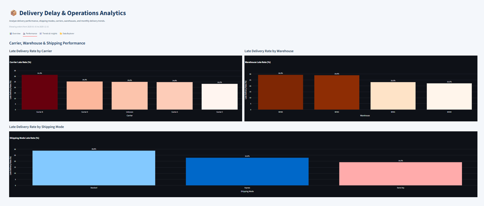
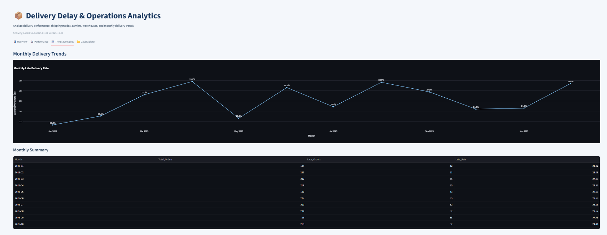
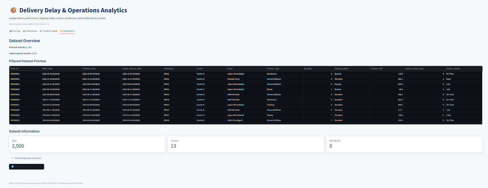

# 🚚 Delivery Delay Analytics Dashboard

An interactive data analytics dashboard built with **Python, Pandas, Streamlit, and Plotly** to explore delivery performance, identify delay patterns, compare carriers and warehouses, and generate actionable business insights.

## 📌 Project Overview

Delivery Delay Analytics is a data analytics project designed to understand delivery performance through interactive visualizations and key performance indicators (KPIs).

The dashboard allows users to explore delivery status, compare shipping performance, analyze trends, and download filtered data and business insights.

> **Dataset Disclaimer:** This project uses a synthetic dataset for educational and demonstration purposes. The results do not represent verified findings from a real company.

## 📸 Dashboard Screenshots

### Overview


### Carrier and Warehouse Performance


### Trends and Insights


### Data Explorer


## ✨ Key Features

- 📊 Delivery status overview and key performance indicators
- 🚚 Carrier performance comparison
- 🏭 Warehouse performance ranking
- 📦 Shipping-mode performance analysis
- 📈 Delivery trend analysis
- 📍 Distance versus delivery-delay visualization
- 💡 Rule-based business recommendations
- 🔎 Interactive filters for exploring delivery data
- 📥 CSV downloads for filtered data and business insights

## 🛠️ Technologies Used

- **Python** — Core programming language
- **Pandas** — Data processing and analysis
- **Streamlit** — Interactive dashboard development
- **Plotly** — Interactive charts and visualizations

## 📁 Project Structure

```text
Delivery_Delay_Analytics/
├── Data/
│   ├── cleaned_delivery_dataset.csv
│   └── delivery_delay_dataset.csv
├── screenshots/
│   ├── overview.png
│   ├── performance.png
│   ├── trends-insights.png
│   └── data-explorer.png
├── dashboard.py
├── requirements.txt
└── README.md
```

*This is a simplified structure of the main project files. Other learning files and configuration folders may also be present.*

## ⚙️ Installation and Setup

### 1. Clone the repository

```bash
git clone https://github.com/kishan-kumawat112/Delivery_Delay_Analytics.git
```

### 2. Open the project folder

```bash
cd Delivery_Delay_Analytics
```

### 3. Install dependencies

```bash
pip install -r requirements.txt
```

### 4. Run the dashboard

```bash
python -m streamlit run dashboard.py
```

### 5. Open the dashboard

Open the local URL displayed in your terminal, usually:

```text
http://localhost:8501
```

## 📂 Dataset

The project includes CSV files in the `Data/` directory. The dashboard should use the dataset path configured in `dashboard.py`.

The analysis explores delivery dates, delivery status, carriers, warehouses, shipping modes, distance, and delay patterns, depending on the fields available in the dataset.

## 🔍 How the Analysis Works

The dashboard compares the actual delivery date with the promised delivery date to classify delivery outcomes:

- **Late:** Actual delivery occurs after the promised date.
- **On Time:** Actual delivery occurs on the promised date.
- **Early:** Actual delivery occurs before the promised date.

The dashboard also presents comparisons and rule-based recommendations to help identify areas for further investigation. These recommendations do not prove the underlying cause of a delay.

## 🎓 Learning Outcomes

- Data analysis and manipulation using Pandas
- KPI calculation and aggregation
- Interactive dashboard development with Streamlit
- Data visualization using Plotly
- Data filtering and CSV export
- Communicating analytical findings through business insights

## 🚀 Future Improvements

- Deploy the dashboard online
- Add automated tests for data processing
- Improve handling of missing and invalid data
- Expand route-level and regional analysis
- Add further analytical methods and forecasting

## 👨‍💻 Author

**Kishan Lal Kumawat**

- GitHub: [@kishan-kumawat112](https://github.com/kishan-kumawat112)


